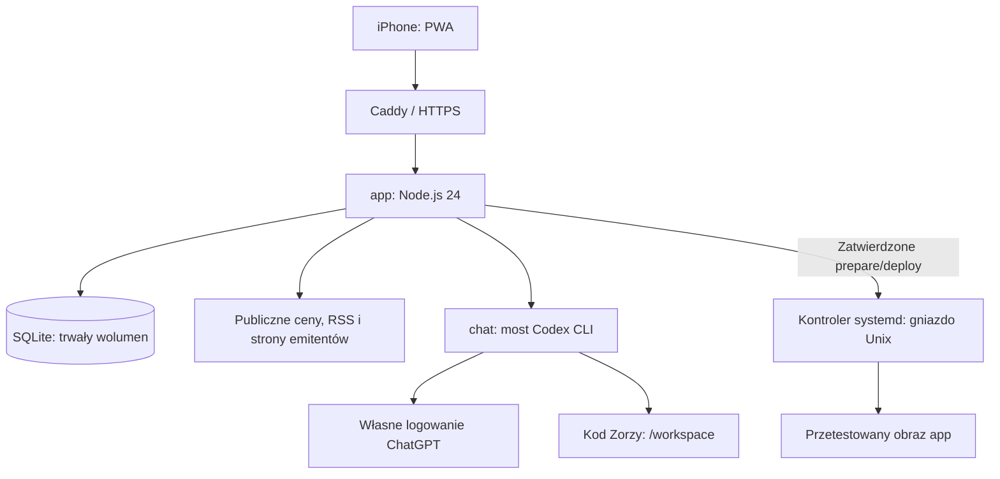

# Zorza — specyfikacja techniczna

Wersja 1.2 · 5 listopada 2026
Odpowiada [PRD 1.2](PRD.md). Opisuje potwierdzone wdrożenie `4585972331e64c66aa95c672bab3c14f` z 5 listopada 2026, 14:14:14 czasu polskiego. Osobne streszczenia artykułów są wyłączone; [stan i dowody](docs/19-brief-zamiast-podsumowan.md). Dokument nie uruchamia automatyzacji ani nie potwierdza późniejszych pobrań.

[Spis projektu](README.md) · [Szczegóły interfejsów](docs/08-api-dane.md) · [Wdrożenia](docs/07-wdrozenie.md)

## 1. Architektura i granice



Aplikacja jest prywatną PWA z jednym użytkownikiem, bez rozdzielania danych wielu użytkowników. Frontend używa HTML/CSS i modułów JavaScript. Backend `server.mjs` udostępnia API, sesje, proces harmonogramu i worker. Node.js 24 zapewnia SQLite; aplikacja nie wymaga zewnętrznych pakietów npm. Codex CLI jest osobnym składnikiem kontenera chat, a kontroler wdrożeń działa w Pythonie na hoście.

| Usługa | Dostęp i odpowiedzialność |
| --- | --- |
| `app` | Prywatne API, dane aplikacji, pobrania i kolejki; użytkownik bez root |
| `chat` | Kod w `/workspace`, własne logowanie i historia; bez bazy portfela, konfiguracji hosta i gniazda Dockera |
| `https` | HTTPS i przekazywanie ruchu do app |
| `zorza-deploy.service` | Zaufane testowanie, budowanie, publikacja app i rollback; poza kontrolą kodu agenta |

Stan aplikacji jest w `/opt/zorza/data`, konta i czatu w `/opt/zorza/chat-state`, konfiguracja w `/opt/zorza/config`. Te katalogi nie należą do repozytorium. Host współdzieli inne aplikacje; mechanizm Zorzy nie może zmieniać ich danych ani konfiguracji.

## 2. Moduły i powiązanie z wymaganiami

| PRD | Moduły / kontrakt |
| --- | --- |
| FR-01–04, FR-08 | `public/app.js`, `style.css`, `card-dismiss.js`, manifest i service worker |
| FR-05–06 | `quotes.mjs`, `price-history.mjs`, `personal-prices.mjs`, `portfolio.js`, `price-chart.js` |
| FR-07 | `store.mjs`, API zakupu, import i `portfolioPerformance` |
| FR-09–10 | `publication-policy.mjs`, `issuer-sources.mjs`, `collector.mjs`, oryginalne `articles.title` |
| FR-11 — wycofane | `publication-work.mjs` kończy stare zadania bez AI; API i most odrzucają streszczenia. Brief i wspólne odczyty zachowane |
| FR-12–14 | `company-insights.mjs`, `brief-monitor.mjs`, `insight-ai.mjs`, `company-insights.js` |
| FR-15 | `calendar-fetch.mjs`, `issuer-calendar.mjs`, `event-extraction.mjs`, `event-windows.mjs` |
| FR-16 | `settings.mjs`, funkcje `scheduled*` w `server.mjs`, trwałe sloty |
| FR-17–18 | `chat-bridge.mjs`, `chat-images.mjs`, `deployment/controller.py`, testy błędów i wersji |
| FR-19 | `chat-sync.mjs`, `data-sync.js`, `article-reader.mjs`, lekkie widoki dashboardu; szczegóły w sekcji 14 |

## 3. Reguły zakresu

Zbiór osobisty jest liczony z danych bazy:

```sql
SELECT i.id FROM instruments i
WHERE i.watched = 1
   OR EXISTS (SELECT 1 FROM purchases p WHERE p.instrument_id = i.id);
```

Ta sama pozycja w obu grupach nie tworzy drugiego zadania. Obserwowanie jest flagą, a portfel wynika z istnienia zapisu zakupu; aplikacja nie prowadzi pełnego rejestru sprzedaży. Usunięcie wszystkich zakupów nie usuwa obserwowania.

Ceny mogą obejmować katalog według ustawienia zakresu. Publikacje, sprawdzanie stron emitentów i opisy są ograniczone do zbioru osobistego także przy `force` lub przekazaniu `instrumentIds`. Wyłączenie opisów przez `insightsScope=disabled` nie wyłącza zwykłego pobierania publikacji.

## 4. Model danych

Migracje SQLite wykonuje `createStore`. Używane są WAL, klucze obce i oczekiwanie na blokadę do 5 s. Identyfikatory i znaczniki wersji łączą treść, źródła i zadania; aktualizacja źródła nie może przypisać starego wyniku nowej treści.

| Encja | Najważniejsze pola i niezmienniki |
| --- | --- |
| `instruments` | `id`, nazwa, typ, ticker, branża, `watched`, opcjonalna zweryfikowana domena; katalog w `catalog.json` |
| `purchases` | `instrument_id`, dodatnia ilość, cena ≥ 0, waluta, poprawna data, `created_at`; import wykrywa dokładną zgodność |
| `quotes` | Jeden rekord na podmiot: cena, procent, waluta, `as_of`, źródło; nie cofamy czasu notowania |
| `price_history` | Cache serii identyfikowanej zakresem i instrumentem; czas odczytu niezależny od czasu punktu |
| `sources` | Podmiot, URL, domeny/reguły, aktywność, ETag, modyfikacja, ostatnie sprawdzenie/sukces/błąd |
| `articles` | Podmiot i źródło, oryginalne `title`, URL, publikacja/odkrycie, `content_hash`, status treści, podsumowanie, odczyt, ważność i miękkie usunięcie; unikalne `(instrument_id, url)` |
| `article_page_cache` | URL, walidatory HTTP, wyodrębniony tekst i `checked_at`; wspólny odczyt w cyklu, ponowna weryfikacja w następnym. Tabelę tworzy czytnik artykułów przy pierwszym użyciu |
| `revisions` | Historia poprzednich wersji treści |
| `jobs` | Starsze zadania indywidualnych streszczeń, wycofane z zakresu produktu; unikalne `(article_id, content_hash)`, dzierżawa i stan |
| `company_insights` | Opis, hash wejścia/zmiany/odczytu, status, `checked_at`, `generated_at`, `changed_at`, ostatni slot |
| `insight_jobs` | Wersjonowane wejście, hash i stan; unikalne `(instrument_id, input_hash)` |
| `brief_monitors` | Aktywność, moment włączenia, potrzeba sprawdzenia i domeny podmiotu |
| `brief_seen` | Wersja i podpis przetworzonego materiału; chroni przed ponownym opracowaniem |
| `brief_entries` | Rodzaj, tekst, źródła, czas utworzenia i wygaśnięcia; opcjonalny termin/przedział |
| `events` | Źródłowy artykuł, tytuł, data, `certainty`, dowód, status, URL, precyzja i koniec przedziału |
| Pozostałe | `instrument_comments`, `sessions`, `locks`, `meta`, `runs`; `headline_cache` i `title_pl` to zachowana historia wyłączonych tłumaczeń |

Daty wykonania i źródeł zapisujemy jako ISO 8601 z jednoznaczną strefą; dni wydarzeń jako `YYYY-MM-DD`. Prezentacja używa `Europe/Warsaw`. Samego `checked_at` nie wolno pokazać jako daty kursu lub wygenerowania opisu.

Kwoty i wyniki zakupów są grupowane według waluty; system nie sumuje różnych walut bez przelicznika. Niepełna wycena wskazuje brakujące podmioty. To informacyjna wycena zapisów, nie księgowość brokerska ani raport podatkowy.

## 5. Pobieranie i wyświetlanie kursów

1. Wybierz podmioty i ich potwierdzone mapowania z `quote-sources.json`.
2. Pobierz publiczne dane Yahoo Finance zwykłym kodem; sprawdź symbol, walutę, typ i skonfigurowane cechy instrumentu.
3. Zapisz cenę sesji regularnej, zmianę wobec poprzedniego zamknięcia oraz czas źródłowy. Nie wpisuj czasu pobrania w miejsce czasu notowania.
4. Starsza odpowiedź nie nadpisuje nowszej. Przy błędzie zachowaj poprzednią wartość i raportuj brak/błąd; bez zastępczych fikcyjnych cen.
5. `/api/quotes` zasila wspólną pamięć listy i profilu. Otwarte okno lub fokus pola wyszukiwania nie wstrzymuje tego odczytu.

Ranking korzysta z dostępnych, porównywalnych notowań. Punkt wskazany na wykresie ma własną etykietę i nie staje się bieżącą ceną całego profilu.

| Zakres wykresu | Punkty / cache |
| --- | --- |
| `1d` | 5 min / 15 min |
| `1w` | 30 min, pięć sesji / 30 min |
| `1y` | Dzienne / 6 h |
| `5y` | Tygodniowe / 24 h |

Historia jest pobierana na żądanie zakresu. Równoległe żądania tej samej serii łączą się w jedno; maksymalnie dwa pobrania historii naraz. HTTP 401/403/429 wstrzymuje następne pobrania historii na 30 min. Braki przerywają linię; historia nie jest wydłużana przed debiut. Seria nie uwzględnia reinwestowania dywidend. Szczegóły: [notowania](docs/04-notowania.md).

## 6. Publikacje i wycofany mechanizm streszczeń

Źródła wynikają ze zweryfikowanej branży i domen emitenta. Zapytania wyszukiwania RSS używają okna ostatnich 30 dni; zapisane archiwum i kanały emitentów mogą zawierać starsze materiały. Nie jest to obietnica odczytania wszystkich publikacji. Wydawca i powiązanie podmiotu są sprawdzane przed przyjęciem materiału. Nieznana branża korzysta ze zweryfikowanych źródeł ogólnych, bez zgadywania portali.

`publication_kind=press` oznacza komunikat emitenta. `research` oznacza materiał jednorazowego opracowania: ukryty na listach nowych publikacji i wyłączony z przyrostowego briefu. Miękkie usunięcie zapobiega przywróceniu artykułu przez kolejne RSS.

Oryginalny tytuł `articles.title` służy do wszystkich nagłówków i wyszukiwania. Stare `title_pl` nie jest eksponowane jako nagłówek. Stan tłumaczeń: `disabled`; `/api/title-retry` zwraca 410. Nie wykonujemy modelowej identyfikacji języka każdego tytułu. Reguły źródeł wybierają przede wszystkim materiały angielskie; polski tytuł zatwierdzonego zagranicznego wydawcy jest dopuszczalny.

Opracowanie publikacji odbywa się w przyrostowym briefie z sekcji 7. Osobne streszczenia pojedynczych artykułów, także na żądanie, są wycofane z zakresu. Nie należy dodawać drugiego wywołania AI dla tego samego celu.

Stan techniczny: usunięto przyciski, sekcje streszczeń, automatyczne odpytywanie wyników i panel analizy screenów pojedynczego artykułu. API `/api/summarize`, `/api/retry` oraz worker `/api/worker/claim` i `/api/worker/finish` zwracają 410. Migracja przy starcie kończy `queued` i `running` w starszej tabeli `jobs` jako `failed`, z przyczyną wyłączenia; nie kasuje treści. Starszy CLI nie pobiera zleceń ani nie wywołuje modelu. Most odrzuca `kind=summary` przed sprawdzeniem konta i naliczeniem operacji; `runPublicationAI` blokuje ten rodzaj również przed utworzeniem plików lub uruchomieniem CLI. Worker serwera obsługuje bezpośrednio osobne `insight_jobs`, zachowując Sol low i harmonogram. [Potwierdzenie](docs/19-brief-zamiast-podsumowan.md).

## 7. Sytuacja firmy i przyrostowy brief

### Aktywacja i wejście

Dodanie obserwowania lub pierwszego zakupu synchronizuje `brief_monitors` i uruchamia sprawdzenie źródeł. Pierwszy opis nie czeka na dzień tygodnia. Gdy źródła nie dostarczą materiałów, pozostaje stan braku danych, nie fikcyjny opis.

Bieżąca partia obejmuje do 20 nowych materiałów. Pierwszy opis może użyć do 20 materiałów z ostatnich 14 dni, ale tablice briefu mogą cytować tylko `brief_article_ids` — źródła nowe od aktywacji monitoringu. Materiały researchu nie wchodzą do tej selekcji.

Budżet automatycznego wejścia: do 8 000 znaków fragmentów łącznie, do 1 600 na materiał, do 10 źródłowych wydarzeń; całe zadanie mostu do 26 000 znaków JSON. Model nie ma narzędzi ani samodzielnego wyszukiwania w sieci.

### Wynik i walidacja

Jedno zadanie `insight` przygotowuje opis i osobny brief przez `gpt-6.1-sol`, reasoning `low`. Schemat zawiera:

```text
Opis: overview, drivers[], risks[], conclusion,
      situation_dates[], followups[], price_context, limitations
Brief: events[], actions[], deadlines[]
Sterowanie: material_changed
Każde ustalenie: text + sources[]
Termin: date + certainty + opcjonalne precision i end_date
```

Źródła muszą pochodzić z przekazanych artykułów i być aktualne. Twarde limity obejmują 700 znaków pozycji, do czterech źródeł pozycji, do czterech elementów zwykłych tablic, do dziesięciu `situation_dates`, do trzech propozycji dalszego sprawdzenia i 6 500 znaków wyniku JSON. Około 300 słów to cel promptu, nie osobny licznik blokujący zapis.

Hash wejścia obejmuje wersję algorytmu, podmiot, materiały, terminy i reguły początkowego briefu. Sam upływ czasu ani zmiana ceny nie tworzą nowego zadania. Statusy obejmują `empty`, `queued`, `running`, `done`, `failed`; zadanie może stać się `superseded`. `pending` jest także stanem odpowiedzi przy braku zapisanego rekordu. Nie ma automatycznego ponawiania błędów modelu.

Brak `material_changed` nie blokuje nowego punktu briefu. Niezmieniony, nadal ważny opis zachowuje treść i `generated_at`; zapisujemy osobne sprawdzenie źródeł. Zmiana materialna lub dopisanie briefu zmienia `material_hash`; oznaczenie znika dopiero po odczycie tej wersji. Nieaktualne źródło oznacza opis jako nieświeży, zamiast przedstawiać go jako bieżący.

### Retencja

`brief_seen` i podpis materiału chronią przed ponownym przetwarzaniem. `brief_entries` są dopisywane niezależnie od opisu. Wygaśnięcie następuje po sześciu miesiącach kalendarzowych od najstarszej daty publikacji cytowanej w punkcie; wygasłe wpisy nie są aktywnymi punktami. Nie oznacza to automatycznego skasowania wszystkich historycznych rekordów bazy.

`BRIEF_ENDS_AT=2027-05-04T21:59:59.999Z` ogranicza obecne dopisywanie briefu, monitoring opisów i wykonywanie zadań insight. Po polsku: 4 maja 2027, 23:59:59. Przedłużenie wymaga decyzji; nie można utożsamiać tego terminu z retencją każdej wiadomości.

## 8. Terminy i kalendarz

Daty zbieramy z komunikatów, dostępnych stron IR, JSON-LD i jednoznacznych kart Upcoming Events. Kalendarz emitenta ma pierwszeństwo przed archiwum; parser nie łączy daty jednej karty z tytułem sąsiedniej. Domyślnie do trzech stron emitenta na podmiot i do trzech równoległych przebiegów; osobny moduł komunikatów ma odrębny limit odczytów. Brak znalezionej daty nie potwierdza braku wydarzenia.

Każdy termin ma podmiot przez artykuł, dowód i pewność `confirmed` albo `estimated`. Z opisu wolno zapisać datę tylko wtedy, gdy zgadza się z przekazanym źródłowym wydarzeniem; sama proza modelu nie wystarcza. Wpis odrzucony przez użytkownika nie powinien zostać samoczynnie zatwierdzony.

| Precyzja | Zapis i prezentacja |
| --- | --- |
| `day` | Konkretny `event_date`; stopień pewności niezależny od precyzji |
| `month` | Pierwszy i ostatni dzień miesiąca; etykieta np. „styczeń 2027” |
| `quarter` | Pełny kwartał; etykieta kwartału |
| `half` | Pełne półrocze; etykieta np. „I półrocze 2028” |
| `year` | Pełny rok; etykieta roku |

Daty graniczne przedziału są techniczną reprezentacją okresu, nie potwierdzoną datą działania. UI grupuje terminy do 30 dni, do sześciu miesięcy, do roku i późniejsze; trwający przedział nadal jest aktywny. ICS eksportuje pojedyncze zdarzenie całodniowe lub przedział, z końcem wyłącznym i informacją o niepewności.

## 9. Harmonogram, blokady i awarie

Serwer sprawdza harmonogram co minutę, przy `SCHEDULER_ENABLED=1`. Most i SQLite działają na VPS z trwałymi wolumenami; urządzenie klienta nie uczestniczy w wykonywaniu zadań.

| Zadanie | Konfiguracja / znacznik |
| --- | --- |
| Ceny katalogu | `pricesFrequency`; `prices_slot`, raport `quotes_report`; wdrożone 15:40 i 21:45 |
| Dodatkowe ceny osobiste | `personal_prices_slot`, `quotes_focus_report`; codziennie 18:30 niezależnie od ustawień katalogu |
| Publikacje osobiste | `publicationsFrequency`; `publication_slot`; wdrożone codziennie 15:40 |
| Kalendarz osobisty | `calendar_slot`; codziennie 15:40, dodatkowo przy aktywacji i cyklu opisów |
| Opisy / brief | `insightSlot`: poniedziałek/czwartek ≥ 14:30; `insight-fetch/twice-weekly`, wersjonowane `last_slot` |
| Pierwszy opis | Znacznik aktywacji i `needs_check`, bez czekania na slot tygodniowy |

Częstotliwości cen/publikacji dopuszczają `daily`, `twice_daily`, `twice_weekly`. Ten ostatni wariant używa wtorku/piątku 15:40. Zapisane preferencje mają pierwszeństwo; domyślna wartość nowej bazy dla cen to `daily`, a potwierdzona konfiguracja produkcji używa `twice_daily`.

Slot ogranicza ponowne uruchomienie, ale nie oznacza sukcesu każdego źródła. Raporty zawierają pokrycie, błędy i zatrzymanie. Blokady ograniczają równoległą pracę; zajęte pobieranie osobiste nie zapisuje wykonanego slotu. Po restarcie uruchamiamy najwyżej bieżący dostępny slot cen, nie wszystkie zaległe. Całodniowo pominięty poniedziałek/czwartek nie jest automatycznie nadrabiany we wtorek/piątek.

Przejściowe błędy pobrań nie zmieniają źródłowej daty starych danych. Nie deklarujemy automatycznego odzyskania wszystkich pominiętych zadań po długiej awarii. Kontenery produkcyjne mają `restart=unless-stopped`, a Docker i kontroler są włączone jako usługi systemowe. Ważne logowanie ChatGPT pozostaje warunkiem wykonania AI.

## 10. API i stany interfejsu

Wszystkie poniższe ścieżki poza sesją/logowaniem są prywatne. Mutacje wymagają poprawnego Origin. Tabela dokumentuje obecne kontrakty; nie wprowadza nowej wersji API.

| Obszar | Ścieżka / dane |
| --- | --- |
| Logowanie | GET `/api/session`; POST `/api/login`, `/api/logout` |
| Dashboard | GET `/api/dashboard`: podmioty, ceny, zakupy, publikacje, terminy, insights, status i ustawienia |
| Lekkie widoki | GET `/api/dashboard?view=overview\|calendar\|settings`; `omitted` oznacza dane nieprzesłane, nie usunięte; szczegóły w sekcji 14 |
| Mała synchronizacja cen | GET `/api/quotes`; nie zwraca portfela ani artykułów |
| Historia | GET `/api/price-history?id=…&period=1d\|1w\|1y\|5y` |
| Obserwowanie | POST `/api/watch`: `{id, watched: boolean}` |
| Zakup / usunięcie | POST `/api/purchase`: `{instrument_id, quantity, price, currency, purchased_on}`; POST `/api/purchase-delete`: `{id}` |
| Komentarze | GET `/api/instrument-comments?id=…`; POST tej samej ścieżki: `{instrument_id, text}` albo `{instrument_id, delete_id}` |
| Artykuły podmiotu | GET `/api/instrument-articles?id=…`; oryginalne tytuły, `title_pl: null` |
| Artykuły — operacje | POST `/api/read`, `/api/article-star`, `/api/article-delete`, `/api/article-research` |
| Wyłączone streszczenia | POST `/api/summarize`, `/api/retry` → 410; dawny worker claim/finish → 410 |
| Opis i brief | GET `/api/insight?id=…`; POST `/api/insight-read`: `{id, hash}`; POST `/api/insight-retry`: `{id}` |
| Dawne tłumaczenia | POST `/api/title-retry` zwraca 410 |
| Ustawienia | POST `/api/settings`; walidowane pola z `lib/settings.mjs` |
| Terminy | POST `/api/event-review`: `{id, status}`; obecny endpoint zmienia tylko wpis `pending` |
| Czat | `/api/chat/status`, `/api/chat/login`, `/api/chat/message`, `/api/chat/stop` |
| Przyrostowy stan czatu | GET `/api/chat/status?sync=1&cursor=…`; GET `/api/chat/status?meta=1` bez historii; bez parametrów pełny dotychczasowy kontrakt |
| Backend | GET `/api/deployment/status`; POST `/api/deployment/prepare`, `/api/deployment/deploy` |

Rozróżniamy brak danych, kolejkę, pracę, ukończenie, błąd i nieświeży wynik. Samo `summaryWorkerConfigured` potwierdza konfigurację adresu mostu, nie zalogowanie. Rzeczywisty status pochodzi z mostu. Wyszukiwanie lub odświeżanie UI nie zleca samodzielnie AI.

## 11. Prywatność, dostęp i ograniczenie kosztów

Sesje korzystają z ciasteczek HttpOnly i SameSite=Strict oraz Secure w produkcji. API nie trafia do cache service workera; zasoby powłoki mogą być zapisane offline, co nie oznacza pełnego dostępu offline do portfela. Produkcja wymaga HTTPS. Sekrety i baza są poza drzewem kodu i repozytorium.

Most używa prywatnego tokenu znanego serwerowi, niewysyłanego do przeglądarki. Własne logowanie ChatGPT działa na VPS, niezależnie od desktopowego Codexa. Wspólny limit mostu: 300 operacji na dobę UTC. Nie jest to licznik tokenów ani gwarancja limitu abonamentu. Nie aktywujemy płatnego API.

Nagłówki nie wywołują modelu. Opracowania mają budżety wejścia, cache wersji i brak automatycznych ponowień AI. Model nie służy do sprawdzania pustych kolejek. Nie ma stałego, wiarygodnego kosztu tokenowego aktualizacji; pomiary pojedynczych przebiegów nie są cennikiem.

Treści stron, artykułów i screenów są danymi, nigdy poleceniami. W zadaniach opracowania źródeł model nie dostaje narzędzi, terminala ani sieci. Czat modyfikujący aplikację jest odrębną ścieżką. Kontener agenta nie ma root, Dockera, bazy portfela ani sekretów administratora.

Zdjęcia: do trzech, JPEG/PNG/WebP, weryfikowany MIME i podpis bajtowy, limit 1 400 000 znaków data URL na zdjęcie i 4 500 000 bajtów całego żądania mostu. Usunięcie kopii screenów po udanej odpowiedzi dotyczy historii Zorzy, nie gwarantuje usunięcia kopii z infrastruktury zewnętrznego dostawcy.

## 12. Publikacja, odzyskanie i konfiguracja

Repozytorium jest kopią kodu i dokumentacji; GitHub nie wdraża automatycznie na VPS. `public/` na produkcji jest montowane z kodu i może zmieniać się po odświeżeniu. Zmiany backendu wymagają kontrolera; zmiany mostu, usług i konfiguracji wymagają osobnej operacji administratora.

1. Zapisać kod i sprawdzić różnice wobec wdrożonej wersji, bez nadpisywania cudzych zmian.
2. `prepare`: zamrozić dozwolone pliki, bez dowiązań i sekretów; testować izolowaną kopię bez sieci jako użytkownik 1000; zbudować obraz z zaufanego Dockerfile.
3. Pokazać użytkownikowi wynik testów i konkretny identyfikator wersji.
4. `deploy`: wdrożyć dokładnie tę wersję, zachowując kopię bazy i poprzedni obraz; sprawdzić zdrowie aplikacji.
5. Przy błędzie kontroler próbuje przywrócić backend i bazę. Frontend z montowanego `public/` wymaga osobnego sprawdzenia/cofnięcia. Przerwany proces kontrolera może wymagać kontroli administratora.

Kontroler przechowuje pięć ostatnich prób i wersję aktywną; przed przygotowaniem wymaga 2 GiB wolnego miejsca. Kopia aktywnego SQLite używa API backup, nie kopiowania samego pliku przy otwartym WAL. Dane testowe ani auth ChatGPT nie mogą trafić do obrazu lub GitHuba.

Główne zmienne są w [.env.example](.env.example): `APP_ORIGIN`, `APP_PASSWORD_HASH`, `WORKER_TOKEN`, `DATA_DIR`, `SCHEDULER_ENABLED`, `CHAT_BRIDGE_URL`, `CHAT_BRIDGE_TOKEN`, `CHAT_STATE_DIR`, `DEPLOY_SOCKET`. Sekrety pozostają puste w przykładzie. `DEV_MODE=1` służy wyłącznie podglądowi lokalnemu.

Repozytorium zawiera komplet modułów mostu, w tym `insight-ai.mjs`. Szablony Compose, Dockerfile kontrolera i jednostka systemd nie zastępują aktywnej konfiguracji hosta. Nie wolno publikować obrazu mostu przez przypadkowe ponowne budowanie starej konfiguracji.

## 13. Weryfikacja i bramki kolejnego wydania

| Obszar | Minimalny dowód |
| --- | --- |
| Ceny | Walidacja symbolu/waluty/typu, zachowanie nowszej daty, brakujące mapowania i 18:30 tylko zakresu osobistego |
| Publikacje | Źródło zagraniczne i właściwy podmiot, oryginalny tytuł, brak pracy tłumaczeń; brak przycisków i nowych zadań osobnych streszczeń (FR-11 wycofane) |
| Opisy / brief | Pierwszy opis, slot poniedziałek/czwartek, brak AI bez nowych danych, walidacja źródeł, przyrostowość, zmiany/odczyt i retencja |
| Kalendarz | Właściwa data i precyzja, brak daty z sąsiedniej karty, zapis z opisu tylko z dowodem, odrzucenie i aktualizacja |
| API | Sesje, Origin, dane prywatne poza zasobami publicznymi i brak API w cache |
| Mobilność | 390 × 844, przyciski w jednym rzędzie, źródła i daty, gest i animacja z ograniczeniem ruchu |
| Wdrożenie | Niezmienna wersja, testy izolowane, zdrowie app, kopia i ścieżka cofnięcia |
| Praca bez komputera | Aktywny scheduler, trwałe dane, polityka restartu usług, ważne logowanie mostu i raport rzeczywistego wykonania |
| Oszczędny transport | Pełna historia po restarcie mostu, poprawne delty i usuwanie zdjęć, zachowanie danych pominiętych w dashboardzie, ponowna weryfikacja artykułu w nowym cyklu |

Polecenia referencyjne:

```sh
node --test test/*.test.mjs
node --check server.mjs
node --check public/app.js
(cd deployment && python3 -m unittest test_controller.py)
```

5 listopada po wyłączeniu streszczeń przeszło 121 testów aplikacji; wycofane scenariusze generowania zastąpiono testami blokad. Osiem testów kontrolera przeszło wcześniej; kontroler nie był zmieniany w tym etapie. Bez rzeczywistych wywołań AI. Zmiana samych dokumentów nie wymaga ponownego uruchamiania modeli ani pobierania danych na produkcji.

Otwarte decyzje z PRD: przedłużenie cyklu po 4 maja 2027, nadrabianie długich awarii, pełniejsze kalendarze i mapowania. Nie są kontraktami wdrożonego API. Dla SLA, RPO/RTO i docelowego budżetu tokenów nie ustalono wartości; ich określenie i pomiar są osobnym etapem.


## 14. Optymalizacja transportu — zmiana 5 listopada 2026

Pierwszy etap wdrożono i sprawdzono 5 listopada 2026. [Notatka techniczna](docs/18-optymalizacja-transportu.md) dokumentuje wersję, testy, pomiary produkcyjne i ich granice. Optymalizacja realizuje FR-19: zachowuje dotychczasowe funkcje, godziny z sekcji 9, modele oraz zbieranie danych przy wyłączonym komputerze.

- Czat: opcjonalne `GET /api/chat/status?sync=1&cursor=…` zwraca tylko zmienione wiadomości w `sync`, z pełną kolejnością ID i procesowym epoch. `?meta=1` pomija historię. Bez parametrów zachowany jest stary format. Po restarcie lub niepoprawnym cursor następuje reset do kompletu; odpytywanie widocznego czatu pozostaje co 3 s.
- Treści: `article_page_cache` zawiera `url`, `etag`, `modified`, `content_text`, `checked_at`. Wspólny czytnik łączy odczyt dla publikacji i kalendarza jednego slotu. Nowy slot ponownie weryfikuje źródło, korzystając z walidatorów HTTP, bez traktowania niezweryfikowanego starego tekstu jako aktualnego.
- Dashboard: dotychczasowy pełny kontrakt zostaje. `view=overview` pomija artykuły, zlecenia, źródła, wydarzenia i pełną treść insight; `view=calendar` dodaje wydarzenia, `view=settings` źródła. Pola `omitted` i `insight_summaries` pozwalają zachować wcześniej pobrane dane w pamięci klienta. Odczyt `/api/insight` w profilu korzysta z przygotowanego na serwerze opisu.

Nowe zasoby: `public/data-sync.js`, `scripts/chat-sync.mjs`, `lib/article-content.mjs`, `lib/article-reader.mjs`. Obraz mostu musi zawierać `chat-sync.mjs`. Nowy frontend należy publikować po backendzie obsługującym nowy zasób i parametry widoków. Nie dodano cache prywatnych odpowiedzi API w service workerze.

Odczyt strony zachowuje do 14 000 znaków wyodrębnionego tekstu, bez pełnego HTML; pula przechowuje najwyżej cztery konteksty slotów. Nowy cykl wykonuje warunkowy GET przy dostępnych walidatorach albo pełny GET bez nich. HTTP 304 potwierdza cache, HTTP 200 zastępuje treść; błąd lub odmowa nie pozwala wykorzystać poprzedniego tekstu jako aktualnego. `no-store` usuwa zapis trwały. Kontrola domen pozostaje odrębna dla każdego podmiotu.

W produkcji sprawdzono Start, pełny profil, publikacje, Kalendarz i Ustawienia przy 390 × 844. Potwierdzono aktywny scheduler, gotowość zalogowanego mostu i kontenery z `restart=unless-stopped`. Kontrolne skróty obserwowanych, zakupów i komentarzy pozostały zgodne. Weryfikacja nie uruchamiała opracowań AI ani pełnego zbierania danych poza harmonogramem; nie dowodzi wykonania przyszłych cykli.
