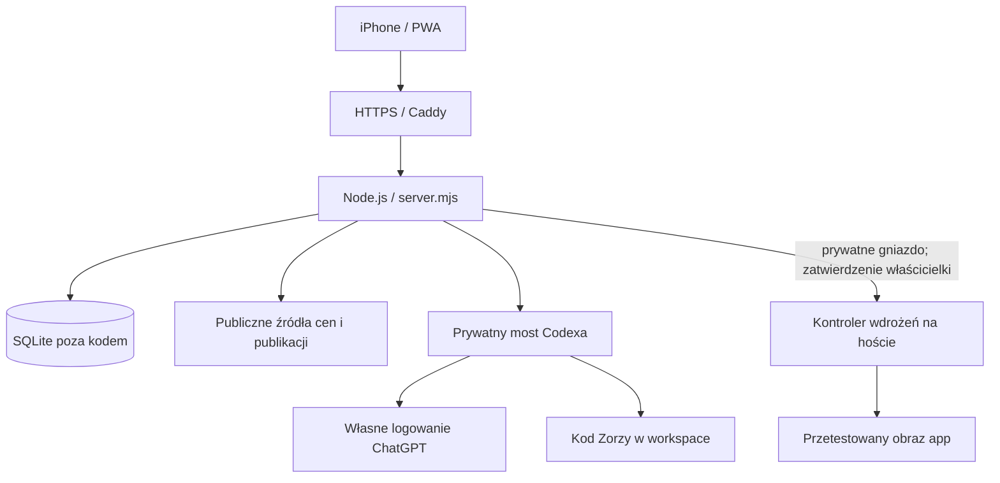

# Architektura

[Spis dokumentacji](../README.md)

## Usługi

**app:** Node.js 24, prywatne API, SQLite, harmonogramy, interfejs PWA. Proces bez root, system plików kontenera tylko do odczytu; osobny trwały katalog danych. `public/` jest montowany z kodu i ma podgląd zmian po odświeżeniu.

**chat:** odrębny kontener z Codex CLI i `scripts/chat-bridge.mjs`. Użytkownik 1000, kod w `/workspace`, własny stan logowania w `/state`. Nie ma produkcyjnej bazy portfela, konfiguracji hosta, gniazda Dockera ani danych innych aplikacji. Korzysta z izolacji kontenera; nie należy przyznawać mu uprawnień hosta.

**https:** Caddy kieruje ruch do Zorzy. Na współdzielonym VPS inne aplikacje zachowują własne konfiguracje i dane.

**zorza-deploy:** zaufany kontroler systemd na hoście. Przyjmuje ograniczone operacje, testuje oddzielną kopię, buduje obraz i publikuje tylko usługę app.

## Najważniejsze moduły

| Plik | Odpowiedzialność |
| --- | --- |
| `server.mjs` | sesje, API, harmonogram i uruchamianie kolejki |
| `lib/store.mjs` | SQLite, migracje, publikacje, wersje, zakupy, blokady |
| `lib/quotes.mjs`, `lib/price-history.mjs` | notowania i historia |
| `lib/publication-policy.mjs`, `lib/issuer-sources.mjs` | dobór i weryfikacja źródeł |
| `lib/collector.mjs`, `lib/calendar-fetch.mjs` | pobieranie RSS i dat |
| `lib/publication-work.mjs` | zlecenia podsumowań i partie nagłówków |
| `scripts/publication-ai.mjs` | ograniczony prompt i wynik zgodny z JSON Schema |
| `public/app.js`, `public/portfolio.js` | widoki, synchronizacja wyników i obliczenia |
| `public/price-chart.js` | wykres i odczyt punktów |

Przy aktualizacji repozytorium nie kopiuj danych wykonawczych. Historyczne skrypty `codex-worker.mjs` pozostają w kodzie, ale obecna produkcyjna ścieżka podsumowań korzysta z mostu i `publication-work.mjs`.
