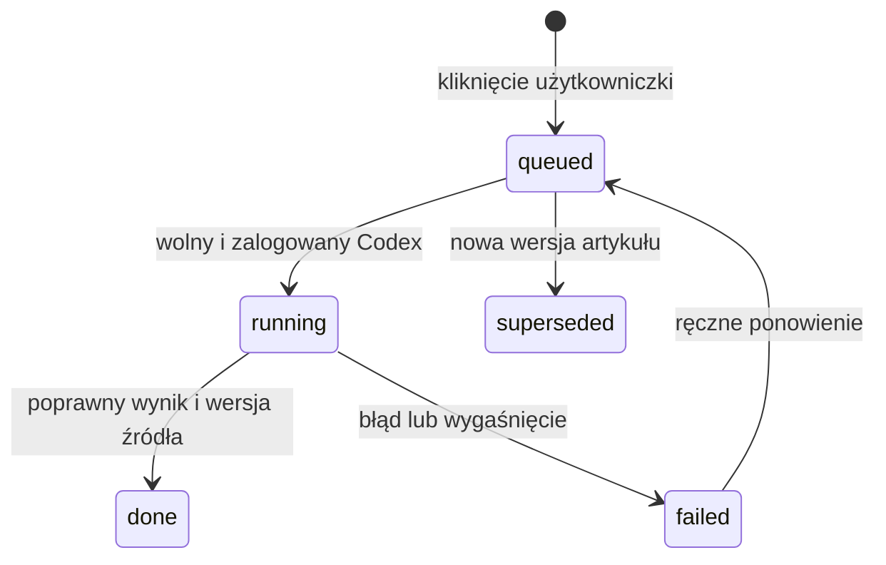

# Prasówka, źródła i AI

[Spis dokumentacji](../README.md)

## Dobór publikacji

Każdy artykuł jest przypisany do instrumentu. Do prasówki trafiają zweryfikowane zagraniczne źródła ogólnofinansowe i branżowe oraz oficjalne domeny spółek i emitentów ETF-ów. Reguły są w `publication-policy.mjs` i `issuer-sources.mjs`. Polski interfejs nie oznacza korzystania z polskich portali.

`syncPublicationSources` odtwarza źródła z aktualnego katalogu i branży. `sources.json` jest zapisem generowanym. Nowy zatwierdzony podmiot powinien mieć `working_group` i opcjonalnie zweryfikowany `official_url`. Dla nieznanej branży działają źródła ogólnofinansowe; specjalistycznych domen nie należy dopisywać bez weryfikacji.

Źródło jest sprawdzane także przy przyjmowaniu artykułu, nie tylko przy tworzeniu kanału. Komunikaty emitentów mają `publication_kind=press`. Pozostałe kategorie obejmują wyniki, kontrakty, działania i inne doniesienia. Kategorie przed opracowaniem mogą być wstępne.

## Nagłówki

Na listach są nagłówki, podmiot, wydawca i data. Dla obserwowanych oraz portfela nowe tytuły są tłumaczone na polski partiami do 20, maksymalnie 100 unikalnych tytułów na polski dzień. Cache rozpoznaje powtórzenia. Pozostałe podmioty mają oryginalne nagłówki.

Prasówka dzieli materiały na Dzisiaj, Wczoraj, Przedwczoraj i Archiwum. Nieprzeczytane i oznaczenie ważności są trwałe; usunięty wpis nie wraca po następnym pobraniu.

## Podsumowania na żądanie

Zlecenie ma powiązanie z hashem treści i dzierżawę. Wynik jest walidowany przed zapisem. Model dostaje ograniczony tekst i ścisły schemat, a treści źródłowe nie mogą sterować narzędziami.

Tekst ma zwykle 3–4 krótkie polskie zdania. Gdy danych jest mało, może być krótszy. Podstawa opracowania jest jawna: pełny tekst, fragment lub nagłówek. Paywalle i blokady nie są obchodzone. Samo otwarcie gotowego tekstu nie wywołuje modelu.

Interfejs pobiera stan tylko widocznych oczekujących podsumowań. Gotowy wynik zastępuje stary status również w otwartym oknie, a opóźniona odpowiedź nie usuwa już zapisanego wyniku tej samej wersji.

Przycisk Więcej źródeł uruchamia osobne wyszukiwanie doniesień. Daty tych wyników oznaczają daty publikacji, nie daty wydarzeń.
