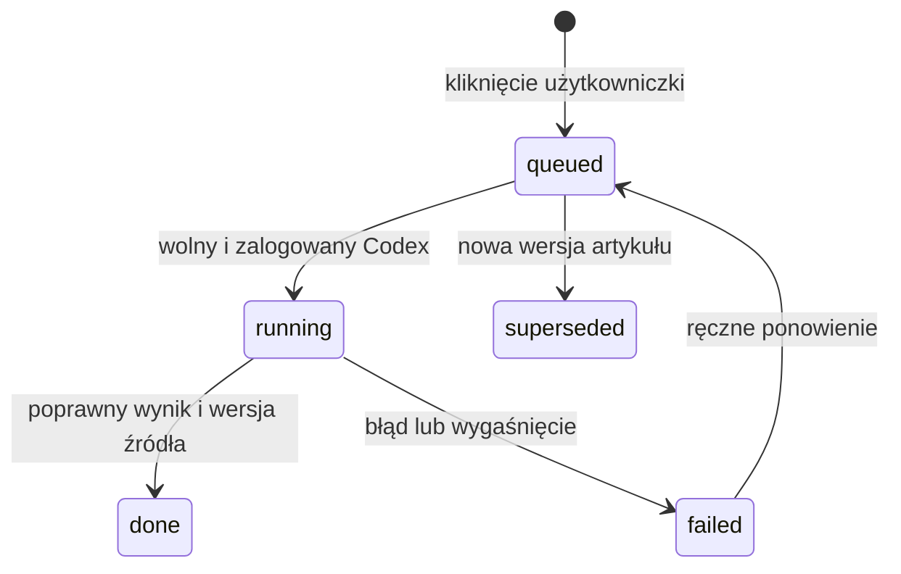

# Publikacje, źródła i AI

[Spis dokumentacji](../README.md)

## Dobór publikacji

Każdy artykuł jest przypisany do instrumentu. W publikacjach profilu są zweryfikowane zagraniczne źródła ogólnofinansowe i branżowe oraz oficjalne domeny spółek i emitentów ETF-ów. Reguły są w `publication-policy.mjs` i `issuer-sources.mjs`. Polski interfejs nie oznacza korzystania z polskich portali. Nie ma osobnej zakładki Prasówka.

Pobieranie publikacji i komunikatów obejmuje tylko obserwowane LUB zakupione podmioty. Dodanie do którejś grupy włącza pobranie; usunięcie z obu zatrzymuje nowe pobrania i zachowuje historię.

`syncPublicationSources` odtwarza źródła z aktualnego katalogu i branży. `sources.json` jest zapisem generowanym. Nowy zatwierdzony podmiot powinien mieć `working_group` i opcjonalnie zweryfikowany `official_url`. Dla nieznanej branży działają źródła ogólnofinansowe; specjalistycznych domen nie należy dopisywać bez weryfikacji.

Źródło jest sprawdzane także przy przyjmowaniu artykułu, nie tylko przy tworzeniu kanału. Komunikaty emitentów mają `publication_kind=press`. Pozostałe kategorie obejmują wyniki, kontrakty, działania i inne doniesienia. Kategorie przed opracowaniem mogą być wstępne.

## Nagłówki

Na listach są oryginalny nagłówek, podmiot, wydawca i data. Tłumaczenie nagłówków jest wyłączone; angielski lub polski tytuł jest widoczny od razu. Stare tłumaczenia i cache pozostają wyłącznie jako historia. Worker nie zleca tłumaczeń, a most odrzuca `titles` przed uruchomieniem CLI. Szczegóły: [oryginalne nagłówki](17-oryginalne-naglowki.md).

Prasówka dzieli materiały na Dzisiaj, Wczoraj, Przedwczoraj i Archiwum. Nieprzeczytane i oznaczenie ważności są trwałe; usunięty wpis nie wraca po następnym pobraniu.

## Podsumowania na żądanie

Zlecenie ma powiązanie z hashem treści i dzierżawę. Wynik jest walidowany przed zapisem. Model dostaje ograniczony tekst i ścisły schemat, a treści źródłowe nie mogą sterować narzędziami.

Tekst ma zwykle 3–4 krótkie polskie zdania. Gdy danych jest mało, może być krótszy. Nowe automatyczne podsumowanie na żądanie wymaga odczytu treści artykułu; jeśli dostępny jest tylko nagłówek lub fragment RSS, aplikacja zapisuje przyczynę braku dostępu i nie uruchamia AI. Istniejące starsze opracowania zachowują oznaczenie swojej podstawy. Screeny mogą być osobną podstawą dopiero na jawne żądanie w czacie. Paywalle i blokady nie są obchodzone. Samo otwarcie gotowego tekstu nie wywołuje modelu.

Interfejs pobiera stan tylko widocznych oczekujących podsumowań. Gotowy wynik zastępuje stary status również w otwartym oknie, a opóźniona odpowiedź nie usuwa już zapisanego wyniku tej samej wersji.

Przycisk Więcej źródeł uruchamia osobne wyszukiwanie doniesień. Daty tych wyników oznaczają daty publikacji, nie daty wydarzeń.

## Wspólny odczyt treści

Od wdrożenia z 5 listopada publikacje i kalendarz tego samego cyklu współdzielą odczyt artykułu przez `article-reader.mjs`. Trwały cache zawiera tekst i walidatory HTTP, bez pełnego HTML. Następny cykl ponownie weryfikuje źródło; błąd lub blokada nie udostępnia starego tekstu jako aktualnego, a `no-store` wyłącza zapis trwały. Kontrola domen pozostaje osobna dla każdego podmiotu.

Nie zmienia to harmonogramu, zakresu ani zlecania podsumowań. Szczegóły: [optymalizacja transportu](18-optymalizacja-transportu.md).
